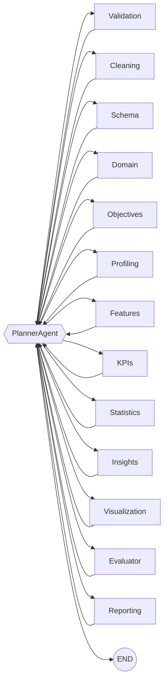

# DataForge AI v2.0

> Autonomous business intelligence engine: upload a dataset, and 13 graph-orchestrated agents turn it into KPIs, ranked insights, charts and an executive report.

**Live demo:** https://dataforge-ai-two.vercel.app (API: https://dataforge-api-purm.onrender.com/docs — free tier, the first request after idling takes ~1 min)


DataForge AI does the first pass a senior analyst would do on an unfamiliar dataset — validate it, clean it, work out what business it describes, compute the KPIs that matter for that business, find the correlations, outliers and trends, and write it all up — with no configuration and no prompts.

- **Graph, not a pipeline.** A LangGraph planner routes every step: agents run only when their inputs exist, failed agents are retried then skipped, and an evaluator gates the report and triggers remediation.
- **Works offline, better with an LLM.** Every agent has a deterministic rule-based path. With an Anthropic or OpenAI key, the LLM also writes the executive narrative and recommendations, breaks ties in domain detection, and drafts business objectives.
- **Auditable.** Every cleaning decision, skip, retry and quality check is recorded in the state and the report.
- **Three ways to run it:** CLI, REST + WebSocket API, and a Next.js web app with a live agent graph.

---

## Quick start

```bash
git clone https://github.com/AjmalDanish/dataforge-ai.git
cd dataforge-ai
pip install -r requirements.txt

python -m dataforge analyze datasets/employees.csv          # → output/employees/
python -m dataforge analyze sales.xlsx -o out/ --no-llm     # force rule-based
```

```
DataForge AI v2.0.0
Dataset: datasets/employees.csv
LLM:     anthropic / claude-opus-5-5

  [OK ] phase 1  DataValidationAgent                0.06s  Validation passed successfully (score: 1.00)
  [OK ] phase 2  DataCleaningAgent                  0.08s  Cleaned dataset from 14x8 to 14x8 ...
  ...
  [OK ] phase 7  ReportingAgent                     0.25s  Generated executive report ...

Analysis complete in 4.1s  (domain: hr)
  HTML report:    output/employees/report.html
  JSON report:    output/employees/report.json
  PDF report:     output/employees/report.pdf
```

Supported inputs: **CSV, Excel (.xlsx/.xls), Parquet, JSON** (records or JSON lines), up to 100 MB / 1M rows by default.

### Web app

```bash
# API (http://localhost:8000, docs at /docs)
pip install -r backend/requirements.txt
uvicorn app:app --app-dir backend --port 8000

# Frontend (http://localhost:3000)
cd frontend && npm install
NEXT_PUBLIC_API_URL=http://localhost:8000 npm run dev
```

Upload a file (or click a sample on the home page) and watch the agents run live; results include KPI cards, insights, the LLM narrative, an interactive chart viewer, and HTML/JSON/PDF downloads.

### Docker

```bash
docker build -t dataforge-api .
docker run -p 7860:7860 -e ANTHROPIC_API_KEY=... dataforge-api
```

---

## How it works



Every agent returns to the **PlannerAgent**, which decides what runs next:

| Rule | Behaviour |
|---|---|
| Preconditions | An agent is scheduled only once the state keys it needs exist (e.g. Statistics needs `profile`). |
| Quality gate | A failed agent is retried up to 2 more times, then skipped and recorded in `steps_skipped`. |
| Evaluation loop | If the Evaluator fails a check (no insights, no charts), the owning agent is re-run once and the result re-evaluated. |
| Loop guard | A global step budget (80) ends the run; if it is exhausted the planner still produces a best-effort report. |
| Timeouts | Every agent has a timeout (scaled by `DATAFORGE_TIMEOUT_SCALE`); a timeout counts as a failure. |

### The agents

| Phase | Agent | Produces | LLM use |
|---|---|---|---|
| 1 Intake | DataValidationAgent | `raw_data`, file metadata, validation report | — |
| 2 Prep | DataCleaningAgent | `cleaned_data`, explained cleaning decisions | — |
| 3 Understand | SchemaDetectionAgent | semantic types, keys, measures/dimensions | — |
| 3 Understand | BusinessDomainDetectionAgent | domain (retail, HR, finance, … 10 total) | tie-breaker when rules are unsure |
| 3 Understand | BusinessObjectiveDetectionAgent | business questions the data can answer | generates objectives (templates otherwise) |
| 4 Deep analysis | DataProfilingAgent | per-column profile | — |
| 4 Deep analysis | FeatureEngineeringAgent | temporal parts, ratios, bins | — |
| 4 Deep analysis | KPIDiscoveryAgent | domain KPIs with trends | — |
| 5 Statistics | StatisticalAnalysisAgent | descriptive stats, correlations, outliers | — |
| 6 Synthesis | InsightGenerationAgent | ranked insights with actions | executive narrative + recommendations |
| 7 Output | VisualizationAgent | interactive Plotly charts, KPI cards, dashboard | — |
| 7 Output | EvaluatorAgent | quality verdict + remediation target | — |
| 7 Output | ReportingAgent | `report.html`, `report.json`, `report.pdf` | renders the narrative |

Identifier columns (`id`, `order_id`, …) are excluded from statistics, charts and KPIs, and KPIs are only computed from columns that actually match (no "revenue" computed from an unrelated column).

---

## LLM configuration

| Variable | Default | Purpose |
|---|---|---|
| `ANTHROPIC_API_KEY` / `OPENAI_API_KEY` | — | Enables the LLM steps (Anthropic is preferred when both are set). |
| `LLM_PROVIDER` | auto | Force `anthropic` or `openai`. |
| `LLM_MODEL` | `claude-opus-5-5` / `gpt-4o` | Model override. |
| `DATAFORGE_DISABLE_LLM` | — | `1` forces the rule-based path. |

The Anthropic provider enables server-side refusal fallbacks (`fallbacks: "default"`), so a declined request is retried on a fallback model inside the same call. LLM output is only ever used on top of rule-based findings: the narrative prompt receives computed KPIs and insights and is told not to invent numbers, and any LLM failure falls back silently to the deterministic result.

See [.env.example](.env.example) for every setting.

---

## API

| Method | Path | Description |
|---|---|---|
| `POST` | `/api/analyze` | Upload a file (multipart `file`), returns `run_id` |
| `GET` | `/api/status/{run_id}` | Status, phase, completed/skipped agents, recent events |
| `GET` | `/api/results/{run_id}` | KPIs, insights, narrative, evaluation, chart and report URLs |
| `GET` | `/api/download/{run_id}/{html\|json\|pdf}` | Report downloads |
| `GET` | `/api/runs/{run_id}/files/{path}` | Report assets (the HTML report and its charts) |
| `GET` | `/api/history` | Recent runs |
| `DELETE` | `/api/runs/{run_id}` | Delete a run (requires `X-Admin-Token` if `DATAFORGE_ADMIN_TOKEN` is set) |
| `WS` | `/ws/{run_id}` | Live events: one `{"type": "agent", ...}` per agent step, then `done`/`error` |

Runs execute in a worker thread so the API stays responsive during analysis; run metadata is persisted to `OUTPUT_DIR/<run_id>/run.json` and reloaded on restart. Uploads are streamed to disk with a size cap, run IDs are validated, and asset paths are confined to the run's directory.

---

## Deployment

- **API:** the root [Dockerfile](Dockerfile) runs as a non-root user on port 7860 on any container host. [render.yaml](render.yaml) deploys it to Render's free tier (render.com → New → Blueprint → this repo); free instances sleep when idle, so the first request after a while takes about a minute. Set `FRONTEND_URL` to your frontend origin to restrict CORS, and mount a volume at `/data` to keep runs across redeploys.
- **Frontend:** [netlify.toml](netlify.toml) builds `frontend/` on Netlify; Vercel works with `frontend/` as the root directory. Set `NEXT_PUBLIC_API_URL` to the API URL.

---

## Development

```bash
pip install -r requirements-dev.txt
pytest                                  # 711 tests, ~1-2 min, coverage report in htmlcov/
ruff check dataforge backend tests --select E9,F63,F7,F82
cd frontend && npm run build            # type-checks the frontend
```

CI ([.github/workflows/ci.yml](.github/workflows/ci.yml)) runs the tests on Python 3.11–3.13 with an 85% coverage floor, builds the frontend, and builds and smoke-tests the Docker image.

### Project layout

```
dataforge/
  agents/            13 agents + planner (one file each)
  graph/workflow.py  LangGraph wiring, run_workflow() with live events
  core/              GraphState, domain models, LLM interface, logger
  infrastructure/    file readers, LLM providers, chart engines, PDF renderer
  presentation/cli.py
backend/app.py       FastAPI + WebSocket server
frontend/            Next.js 14 app (upload, live run view, history)
tests/               unit, integration (full pipeline), api
docs/                PRD, TRD, architecture, ADRs, agent docs
```

## Known limitations

- Single-dataset analysis only; no database connectors or multi-file joins yet.
- KPI templates cover retail, HR and finance in depth; other domains fall back to generic KPIs.
- Run storage is the local filesystem (`dataforge/db` holds SQLAlchemy models for a future Postgres backend; they are not wired in).
- The API has no user accounts: anyone who can reach it can upload and view runs. Put it behind your own auth for anything beyond a demo.

## License

MIT — see [LICENSE](LICENSE).
